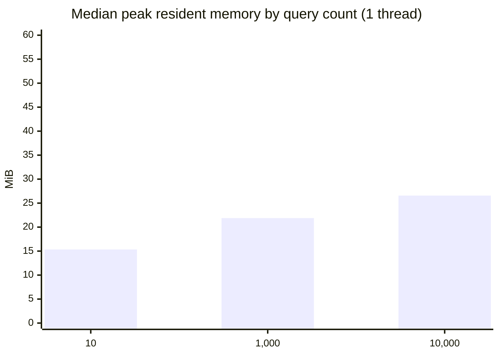
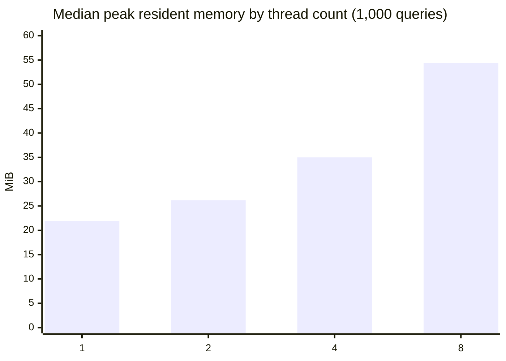
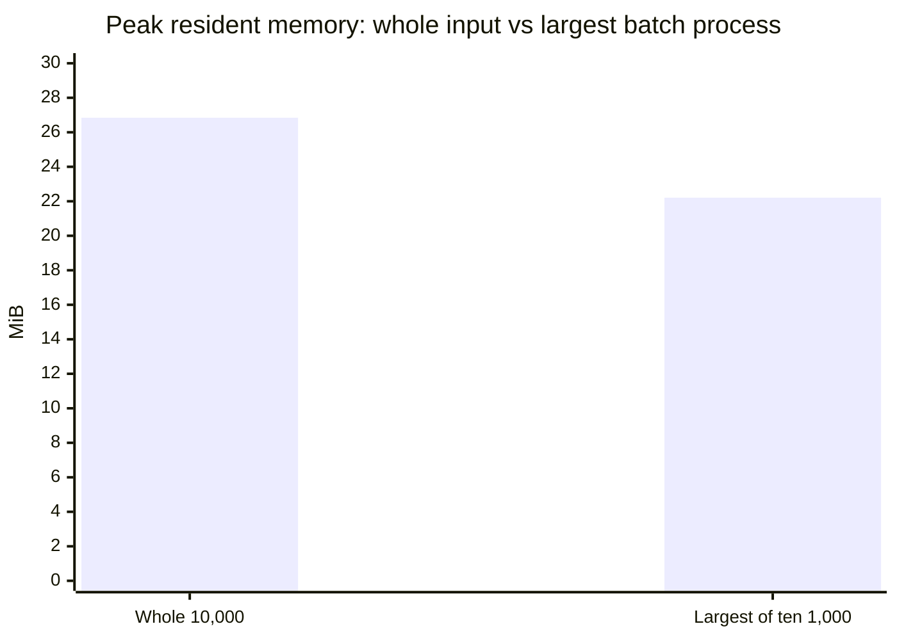
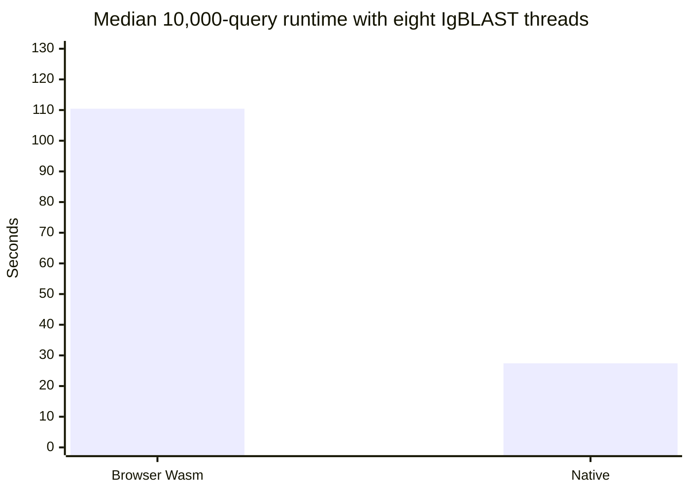
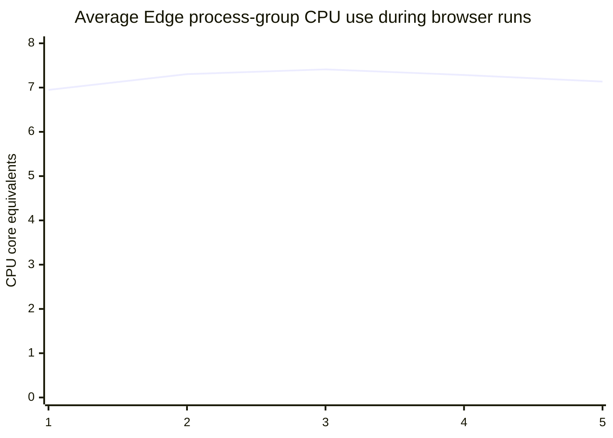

# Stage 6a: native IgBLAST memory study

**Status: complete.** The Stage 7 consolidation is in
[the final report](stage7-final-report.md).

## Scope and method

On 2026-11-11 we ran fresh, sequential `igblastn` processes three times
per case. One thread used 10, 1,000 and 10,000 query records; at 1,000
records, 1, 2, 4 and 8 threads were compared. Only the indicated dimension
changed. This is a bounded diagnostic, not a capacity limit or a statistical
model. A separate 10,000-record batching comparison is reported below.

The script calls Windows [`GetProcessMemoryInfo`](https://learn.microsoft.com/en-us/windows/win32/api/psapi/nf-psapi-getprocessmemoryinfo)
on the IgBLAST process handle approximately every 100 ms and attempts one
final read after exit. It retains the maximum reported
[`PeakWorkingSetSize` and `PeakPagefileUsage`](https://learn.microsoft.com/en-us/windows/win32/api/psapi/ns-psapi-process_memory_counters_ex).
The former is a kernel-maintained resident working-set high-water mark;
the latter is peak private commit charge, not virtual address reservation or
necessarily resident RAM. Values are in MiB (1,048,576 bytes). Because the
last read may fail after exit, a peak occurring after the last successful read
could be missed. The 10-record processes had only 3–4 polling samples.
Child processes, the benchmark driver, filesystem cache and browser memory
are not included. Elapsed time is process launch to completion, with polling
up to about 100 ms and without output validation; reference preparation and
database construction are excluded. Cache was not flushed.

Environment: Windows 11 Pro 10.0.26200; AMD Ryzen Threadripper 3970X,
64 logical processors; 68,585,648,128 bytes physical RAM; Windows PowerShell
5.1.26100.9711; Node v24.21.0. Native `igblastn` reports 1.22.0,
SHA-256 `263901616bf7d712625fe6e5c5bf630923565aa2882229cad47456deeb255f0d`;
native `makeblastdb` reports 2.17.0+,
SHA-256 `5a728497116bddc375c0a345c9458d0b64a8285161b4c792786a60928377abd0`.
No toolchain or binary was downloaded or rebuilt.

## Inputs and validation

The existing Stage 6 generator repeats the 10 sequences in
`tests\fixtures\stage2\query.fasta` 1,000 times, with unique repeat-prefixed
IDs. Smaller inputs are exact prefixes of this generated FASTA:

| Records | Bytes | SHA-256 |
|---:|---:|---|
| 10 | 5,555 | `e7915a3d856b96e25aeff4de0379b519014fa493abcfaf2559bb4ca3ef872903` |
| 1,000 | 555,500 | `e1c616aa777b7251717bed6483226412952147670df9eef84ebfcba56a907fd7` |
| 10,000 | 5,555,000 | `10ac9a2f9344e716a564d08a9d0304ac3d39221c7df3b8b3132ae487261e95da` |

This repeats only ten biological sequences and cannot represent arbitrary
sequence lengths, diversity, difficult alignments or larger reference sets.
The [Stage 6 report](stage6-correctness-and-io.md) explains the OGRDB
fixture preparation and database provenance. We reused its prepared V/D/J
FASTA, `.ndm` and `.aux` files and native BLAST v4 nucleotide databases,
made using `-parse_seqids`; the V database also exists as
`internal_data\human\human_V*`. The database metadata identifies those
prepared FASTAs. Reference SHA-256:

| Artifact | SHA-256 |
|---|---|
| V FASTA | `6c3e1020d27c0a78d0808377077858e1f6f3c9d1b5aa011cb6035c9c6c1f2cb0` |
| D FASTA | `d7c8c8315b561aa2ab8e509ef8c4d101e7e3afb956901626f3390a2bdde823c6` |
| J FASTA | `b62cb2b6ee1a8986beb2d75035d432f4f81ad894df0bf15811ffcb917df9321b` |
| NDM | `96240dd9a5a04e2281c6b18fcc2a375da319516ca65ee22f4fb56556c9a65c00` |
| AUX | `27ae9b86a56c8b9064def0379901484565cd61d27bdcd51526b29250160ccd34` |

Each process uses `-germline_db_V V -germline_db_D D -germline_db_J J`,
the same prepared `-custom_internal_data` and `-auxiliary_data`,
`-organism human -domain_system imgt -ig_seqtype Ig -outfmt 19`, and
the case-specific `-query`, `-num_threads` and `-out`. Its working
directory is the database directory. All outputs had the expected row count,
every unique query ID exactly once, consistent column counts, and nonempty
V calls. These checks do not establish full annotation parity; Stage 6
separately compared all AIRR fields for the 10-record fixture.

## Reproduction

From the repository root in Windows CMD, with the existing ignored Stage 6
results and native executables present:

```cmd
powershell -NoProfile -ExecutionPolicy Bypass -File tools\stage6\native-memory-study.ps1
```

For the separate 10,000-record batching comparison, without rerunning the
18-case study:

```cmd
powershell -NoProfile -ExecutionPolicy Bypass -File tools\stage6\native-memory-study.ps1 -BatchComparison
```

The defaults use `tools\stage6\results\query-10000.fasta`,
`tools\stage6\results\igblast-speed-20261111T174346358Z\browser-artifacts`,
and `tools\stage6\results\igblast-native-only-20261111T174944415Z\native-db`.
Use `-Artifacts` and `-Database` to select equivalent existing paths under
the repository. If the generated query is absent,
`node tools\stage6\generate-10k-fasta.cjs` regenerates it from the fixture;
that generator overwrites its output and manifest, so do not run it over
files you need to preserve. The study writes a new timestamped ignored
directory with input prefixes, TSVs, stderr and JSON summary. It fails on
nonzero exit, timeout, malformed/empty output or unexpected IDs. It does not
rebuild databases or prepare references.

## Results

Each cell lists repetitions in execution order; medians are calculated
separately for each metric. Timings are seconds; memory is MiB.

| Records | Threads | Peak resident, runs | Median | Peak private commit, runs | Median | Seconds, runs | Median |
|---:|---:|---|---:|---|---:|---|---:|
| 10 | 1 | 15.36, 15.34, 15.28 | 15.34 | 7.49, 7.57, 7.42 | 7.49 | 0.39, 0.45, 0.33 | 0.39 |
| 1,000 | 1 | 21.89, 21.88, 21.52 | 21.88 | 14.37, 14.09, 14.23 | 14.23 | 17.74, 17.90, 17.55 | 17.74 |
| 10,000 | 1 | 26.99, 26.30, 26.57 | 26.57 | 19.00, 18.19, 18.80 | 18.80 | 175.25, 175.36, 178.80 | 175.36 |
| 1,000 | 2 | 25.87, 26.16, 26.17 | 26.16 | 19.33, 20.54, 20.07 | 20.07 | 9.32, 9.25, 9.43 | 9.32 |
| 1,000 | 4 | 34.99, 35.29, 34.62 | 34.99 | 30.89, 30.93, 31.78 | 30.93 | 4.94, 4.97, 5.04 | 4.97 |
| 1,000 | 8 | 55.02, 54.42, 52.70 | 54.42 | 52.54, 51.02, 50.20 | 51.02 | 3.07, 3.17, 2.99 | 3.07 |

At one thread, the median resident peak increased from 15.34 MiB at 10
records to 21.88 MiB at 1,000 and 26.57 MiB at 10,000: it was not constant,
but grew much less than record count. At fixed 1,000 records, it rose from
21.88 to 54.42 MiB as threads increased from 1 to 8, about 2.49 times.
Peak private commit showed the same direction. These observations do not
establish why memory grew, whether this trend persists, or browser needs.
The actual ignored run is
`tools\stage6\results\native-memory-20261111T182821364Z\summary.json`;
all 18 outputs passed the checks above. The final script also passed a
separate one-case smoke run after adding the summary hashes.

### Peak resident memory graphs

The x-axis labels below are categories, not a linear numeric scale.





## One invocation versus ten sequential batches

On the same host and with the same references, database and options, one
fresh one-thread process ran all 10,000 records, then ten fresh one-thread
processes ran sequential contiguous 1,000-record chunks. Each row is a
separate process; memory is MiB and elapsed time is seconds. The measurement
and cache limitations above apply. There is one comparison, not repeated
trials of the complete batching arrangement.

| Process | Records | Peak resident | Peak private commit | Seconds |
|---|---:|---:|---:|---:|
| Whole | 10,000 | 26.84 | 18.79 | 174.99 |
| Batch 1 | 1,000 | 21.96 | 14.76 | 17.47 |
| Batch 2 | 1,000 | 21.57 | 14.13 | 17.68 |
| Batch 3 | 1,000 | 22.21 | 14.42 | 17.53 |
| Batch 4 | 1,000 | 21.86 | 14.33 | 16.96 |
| Batch 5 | 1,000 | 21.53 | 14.05 | 17.69 |
| Batch 6 | 1,000 | 22.05 | 14.86 | 17.95 |
| Batch 7 | 1,000 | 21.72 | 14.09 | 18.27 |
| Batch 8 | 1,000 | 21.92 | 14.61 | 18.26 |
| Batch 9 | 1,000 | 21.65 | 14.07 | 17.71 |
| Batch 10 | 1,000 | 21.62 | 13.94 | 17.40 |

Across the ten batch **processes**, the maximum resident peak was 22.21 MiB
and median 21.79 MiB; maximum private-commit peak was 14.86 MiB and median
14.23 MiB. The single whole process had 26.84 MiB resident and 18.79 MiB
private commit. These are separate process peaks, not sums or measured
whole-system/browser peaks.



The batch timings had a median of 17.69 s and maximum 18.27 s; their sum was
176.92 s of measured process durations, not end-to-end wall time, which
additionally includes validation and concatenation. The single whole-run
time was 174.99 s. One ordering and this repeated fixture cannot establish
general batching performance or memory requirements.

The reproducible script validates each batch against its chunk's unique IDs
and its header against the whole output, then rereads the single-header
concatenation and checks that all 10,000 IDs appear exactly once, with
10,000 nonempty V calls. It compares each complete AIRR row to the whole-run
row keyed by `sequence_id`; all 10,000 rows matched across all fields. The
FASTA chunks also reproduce the original input byte-for-byte. The verified
outputs and summary are under the ignored directory
`tools\stage6\results\native-memory-20261111T185554775Z\`.
The timing sum excludes validation and concatenation and is not end-to-end
wall time.
An earlier attempt stopped after the whole invocation due to a harness
validation placement error; the corrected complete run above supersedes it.

## Implications for browser memory

### Candidate thread fallback policy

The user proposed preferring eight IgBLAST threads, falling back to four
then two when memory is tight, and reporting insufficient memory if even
two cannot be used. The existing native study provides these per-process
reference measurements at 1,000 query records; each cell lists three runs
and their median:

| Threads | Peak resident working set (MiB) | Peak commit charge (MiB) |
|---:|---|---|
| 2 | 25.87, 26.16, 26.17 (**26.16**) | 19.33, 20.54, 20.07 (**20.07**) |
| 4 | 34.99, 35.29, 34.62 (**34.99**) | 30.89, 30.93, 31.78 (**30.93**) |
| 8 | 55.02, 54.42, 52.70 (**54.42**) | 52.54, 51.02, 50.20 (**51.02**) |

These are native process measurements, not WebAssembly linear-memory
consumption, total browser-process memory, or app overhead. For the browser,
the only relevant observation here is that the 10,000-record run aborted
under the current Wasm module's fixed 16 MiB linear-memory maximum. We did
not measure Edge's total process working set, the browser's free physical
memory, or memory used by the rest of the app, and this OOM is not a
measurement of the device's memory limit.

Therefore this report does not propose numeric thresholds or implement the
fallback policy. To choose thresholds responsibly, a later browser study
would need to measure the integrated app's baseline and peak memory at 8, 4,
and 2 threads, including Pyodide, the NCBI worker, references/databases,
input/output buffers, and other page overhead on representative devices.
Only after those measurements and user review should the app decide how much
headroom to reserve or when to fall back and report insufficient memory.

The checked-in Stage 2 build script specifies `-pthread`, exceptions, and
`PTHREAD_POOL_SIZE=4`, but no explicit initial/max/growth or memory64 flags
were found in it or the Stage 2 patch. The generated `bin\igblastn.js` creates
**shared** `WebAssembly.Memory` with initial **and maximum** 16,777,216 bytes
(256 64-KiB pages), and its `emscripten_resize_heap` unconditionally aborts.
Thus this artifact cannot grow; 16 MiB is both its initial size and hard
linear-memory maximum, not a 16 GiB browser policy. The generated numeric
memory descriptor and 32-bit pointer operations identify this as memory32,
not a wasm64 build. The precise upstream origin of these settings is not
established by the checked-in script.

[Emscripten settings](https://emscripten.org/docs/tools_reference/settings_reference.html#allow-memory-growth)
distinguish initial memory, growth and a maximum. A memory32 linear memory
has a theoretical 4 GiB address-space ceiling; usable allocation may be
lower, and larger maxima require appropriate toolchain settings
([V8 explanation](https://v8.dev/blog/4gb-wasm-memory)). This is per linear
memory, not a cap on all browser processes or an entitlement to physical RAM.
Current Emscripten documentation says growth is disabled by default and the
maximum defaults to 2 GiB when growth is enabled; these are reference-doc
defaults, not settings verified for the pinned build or a proposed cap.
Wasm64 is a separate rebuild and compatibility question, not a simple larger
limit for this binary. As of this investigation,
[Can I use](https://caniuse.com/wf-wasm-memory64), when checked, listed
Memory64 supported for Chrome 133–160, Edge 133–156 and Firefox 134–163,
and unsupported for Safari and Safari TP through 27.3 TP. These are the
versions listed on that page, whose data may lag current releases; feature-
detect and test actual supported target browsers rather than assume universal
support. Those listings cover Memory64 capability alone, not a verified
Emscripten pthreads + Memory64 build of this application. Pthreads additionally
require shared-memory support and cross-origin isolation
([Emscripten pthreads](https://emscripten.org/docs/porting/pthreads.html)).

Native working set is not directly interchangeable with Wasm linear memory
or total browser use: MEMFS copies, JavaScript, Pyodide, workers, databases
and output may add memory outside an IgBLAST linear heap. A future study
should measure those layers and failures on representative data and devices.
Consider an appropriately tested growable Wasm32 build first, then feature-
detected Wasm64 where practical and needed. Batching lowered the measured
per-process peak in this native fixture comparison, but introduces browser
memory, output/ordering, failure and performance questions; evaluate those
separately rather than silently changing the workflow. Preserve
clear OOM handling and user choice; do not impose an arbitrary 16 GiB cap.

## Follow-up: 250/500 MiB Wasm build and 10,000-query test

**Complete.** At the user's request, the
existing `igblastn` Wasm target was re-linked with a 250 MiB initial memory,
growth enabled, a 500 MiB maximum, and enough Emscripten workers to execute
IgBLAST with `-num_threads 8`. The existing pinned NCBI source, patch,
toolchain, build tree, native binaries, query and prepared Stage 5 references
were reused; nothing was downloaded or cloned, and native binaries were not
rebuilt.

### Build and verification

The existing build tree uses NCBI commit
`f83dd16a0c30899da66d4f6902b5a9ed36c9d433`, the Stage 2 patch
(`1A2CB50AC827D8B5DD81DA63BA90E7233A33DD52A21FA703BB51C99CF67F13CD`) and
Emscripten 7.0.0. The linked JavaScript emits
`WebAssembly.Memory({initial: 4000, maximum: 8000, shared: true})`:
4,000 × 65,536 = 262,144,000 bytes (250 MiB), and 8,000 × 65,536 =
524,288,000 bytes (500 MiB). `CMakeCache.txt` records
`-sALLOW_MEMORY_GROWTH=1`; the generated JS contains the corresponding
`wasmMemory.grow` path. This remains a shared memory32 module, not Memory64.

The first link used `PTHREAD_POOL_SIZE=8`. On the 10-query fixture,
`-num_threads 8` did not complete within 600 seconds; a bounded repeat timed
out at 90 seconds. With that same pool, `-num_threads 4` completed and
assigned five distinct Emscripten workers. Raising the pool to nine made the
eight-thread fixture run complete, with nine workers assigned. The exact
internal reason for the extra worker was not separately traced; the setting
is an Emscripten worker-pool size, not the IgBLAST compute-thread count.
The final five bulk runs all reported eight configured IgBLAST threads and
nine worker instances created and assigned.

The existing build command supports overrides while preserving Stage 2
defaults. From the repository root in Windows CMD, using the existing local
build area:

```cmd
set "STAGE2_TOOLS=D:\copilot-builds\igblast-poc-b12f8502"
set "NCBI_SOURCE=%STAGE2_TOOLS%\ncbi-source"
set "STAGE2_BUILD_DIR=%STAGE2_TOOLS%\build-wasm-pthreads"
set "STAGE2_WASM_TARGETS=igblastn"
set "STAGE2_WASM_LINK_FLAGS=-pthread -fexceptions -sPTHREAD_POOL_SIZE=9 -sINITIAL_MEMORY=262144000 -sALLOW_MEMORY_GROWTH=1 -sMAXIMUM_MEMORY=524288000 -Wl,--error-limit=0"
set "STAGE2_JOBS=8"
call tools\stage2\build-wasm.cmd
```

The successful Ninja action was `[1/1] Linking CXX executable
bin\igblastn.js`; existing compiled objects were reused. Only `igblastn` was
re-linked; the browser `makeblastdb` asset remained unchanged. The new
`igblastn.js` and `.wasm` were copied into `bin` for the local browser
harness. With the build above complete, copy the new pair with:

```cmd
copy /Y "%STAGE2_BUILD_DIR%\bin\igblastn.js" "bin\igblastn.js"
copy /Y "%STAGE2_BUILD_DIR%\bin\igblastn.wasm" "bin\igblastn.wasm"
```

Preserve the current `bin\igblastn.js` and `.wasm` before overwriting them;
the original pair from this test is retained under the backup path below.
The prior worktree and build-area artifact pairs were preserved
under `tools\stage6\results\wasm-memory-250m-500m-8threads\original-assets`;
the intermediate pool-eight pair is under `pool8-assets`. Final worktree
artifact SHA-256 values are `igblastn.js`
`C217C8C0B4A4609246DBAD1E94CD4B9F76DD32F0DEC0DA4034A102669C3B1418` and
`igblastn.wasm`
`EFF8645245100BF3005EA0E53FA2BD23276780BC7E6ED7739D71B3ED388B3B74`.
The original worktree pair was separately backed up with hashes
`B3F7E8A33D7E857C1F3DA9983E09B6A7759CA0FA78A05D7911872885E8DF0246` and
`65158167DF1F0CF111C6A872356390E0F9033B17976AEB4D6242FFDFB4C154D3`.

### Paired 10,000-query comparison

The five test pairs reused the exact Stage 6 query
(`10ac9a2f9344e716a564d08a9d0304ac3d39221c7df3b8b3132ae487261e95da`,
5,555,000 bytes, 10,000 unique IDs) and the existing OGRDB-prepared Stage 5
references. Each side built its own BLAST v4 databases from those same
FASTAs using `-dbtype nucl -blastdb_version 4 -parse_seqids`; database
construction and reference preparation were excluded from timing. Both
sides used IgBLAST 1.22.0, `-organism human -domain_system imgt
-ig_seqtype Ig -outfmt 19 -num_threads 8`, and the same `.ndm`/`.aux`
files. Pair order alternated browser-first and native-first. The reference
hashes are recorded above and in the ignored run manifest.

Reproduction command (references are served locally; no live OGRDB request
is made):

```cmd
node tools\stage6\generate-10k-fasta.cjs
node tools\stage6\benchmark-igblast.cjs --threads 8 --reference-artifacts tools\stage6\results\igblast-speed-20261111T174346358Z\browser-artifacts
```

The timer starts with a fresh native process or browser NCBI worker and ends
after output completion. Browser timing additionally includes OPFS-to-MEMFS
input transfer, output persistence/readback, unique-ID and row validation,
and SHA-256 calculation; native timing includes process launch, file reads,
and the row-count check. Both exclude Edge startup, reference preparation,
database creation and query generation. This compares the browser workflow
path with a native invocation, not only the two compute kernels.

| Pair | Browser (s) | Native (s) | Edge process-group average CPU cores |
|---:|---:|---:|---:|
| 1 | 124.709 | 25.370 | 6.948 |
| 2 | 110.440 | 24.751 | 7.304 |
| 3 | 101.083 | 27.608 | 7.411 |
| 4 | 106.880 | 27.903 | 7.284 |
| 5 | 112.918 | 27.431 | 7.135 |
| **Median** | **110.440** | **27.431** | **7.284** |





The median browser path was 4.026 times slower than the matching native
eight-thread run. The previously recorded Stage 6 native-only median was
172.293 seconds at **one** thread. Comparing that result to the new
eight-thread browser median would make the browser appear 1.56 times faster,
but that is not apples-to-apples. The fresh matched native eight-thread
baseline is the relevant comparator; it was 6.28 times faster than the
earlier native one-thread median on this fixture and host.

The Edge headless test ran on Windows 11 build 10.0.26200, Edge 157, an AMD
Ryzen Threadripper 3970X (32 physical cores, 64 logical). The page reported
`navigator.hardwareConcurrency = 64`. Across the five browser runs,
`SystemInfo.getProcessInfo` measured 6.948–7.411 average CPU-core equivalents
(median 7.284) over the dedicated Edge process group. This includes browser,
renderer, networking and other Edge process time, not only IgBLAST; it is
not an exact count of physical cores reserved by the computation.

All five browser outputs had 10,000 rows, 96 columns, unique query IDs and
the same SHA-256
`d4d7af8411219513357cb0e88e421d417470f0f47b75c1e8c984c4765e0670cb`.
The Stage 2 comparator reported 10,000 rows and zero per-field differences
against the native output. The browser file used LF endings (34,109,211
bytes); native used CRLF (34,119,212 bytes), accounting for one additional
CR per line and their different raw-file hashes. Comparison is by records
and AIRR values, not raw byte identity.

At the end of every browser invocation,
`wasmMemory.buffer.byteLength` was 262,144,000 bytes: this workload did not
grow beyond the initial 250 MiB. This is the current WebAssembly linear
memory size, not the number of bytes occupied by sequences and not total
Edge/app memory. The test did not sample total browser-process peak memory,
free physical memory, Pyodide/app overhead, or a range of devices. It
therefore demonstrates successful completion for this repeated small
fixture on this machine, not a universal capacity guarantee or a basis for a
fixed user-memory threshold. The additional 250 MiB of linear-memory
headroom was available but not used. No fallback policy or hard 16 GiB
limit was implemented.

The full machine-readable results are in
`tools\stage6\results\igblast-speed-20261111T202924364Z\igblast-speed.json`;
browser/native TSVs and the native databases are in the same ignored run
directory.
